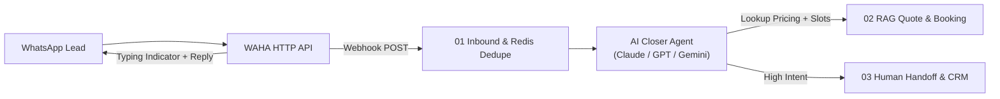

# 24/7 WhatsApp AI Sales & Booking Agent (Self-Hosted n8n + WAHA + Redis)

[](workflows/)
[](docker/docker-compose.example.yml)
[](LICENSE)

> **Respond to inbound WhatsApp leads in under 10 seconds, prevent duplicate replies, qualify prospects, and book calls automatically—without Zapier/Make per-task SaaS bloat.**

Inspired by production self-hosted `n8n` AI sales agent templates (`awesome-n8n-templates`, `n8n-sales-chat-agent`), this modular 3-workflow blueprint combines Redis message deduplication, grounded RAG pricing retrieval, Cal.com slot booking, and instant CRM escalation.

---

## Architecture Flow



---

## Included Workflows & Engineering Assets

| Asset | Purpose | Link |
| :--- | :--- | :--- |
| Workflow 01 | Webhook intake, `fromMe` echo filter, Redis `EX 300` dedupe & AI response | [`whatsapp-ai-closer.example.json`](workflows/whatsapp-ai-closer.example.json) |
| Workflow 02 | Grounded pricing lookup via RAG API + Cal.com availability check | [`02-rag-quote-and-booking.example.json`](workflows/02-rag-quote-and-booking.example.json) |
| Workflow 03 | High-intent prospect PostgreSQL upsert & Account Executive webhook alert | [`03-human-handoff-crm.example.json`](workflows/03-human-handoff-crm.example.json) |
| Guardrails | State machine, opt-out compliance & anti-hallucination rules | [`docs/prompt-and-guardrails.md`](docs/prompt-and-guardrails.md) |
| ROI Breakdown | Monthly cost comparison: Zapier/Make vs Self-Hosted Docker VPS | [`docs/cost-comparison-zapier-vs-n8n.md`](docs/cost-comparison-zapier-vs-n8n.md) |
| Docker Stack | Full sanitized Compose stack (`n8n`, `postgres`, `redis`, `waha`) | [`docker/docker-compose.example.yml`](docker/docker-compose.example.yml) |

### Validate Workflows Locally
```bash
python3 -m unittest discover -s tests -v
python3 scripts/validate_workflows.py
```

---

## Request Custom Deployment & Monthly SLA (`USD 3,500 - 10,000`)
- **LinkedIn Studio:** [Golden Nodalix](https://www.linkedin.com/in/agency-golden-nodalix-880598438/)
- **Profile Hub:** [agenciaiaonline-wq](https://github.com/agenciaiaonline-wq)
- **Email:** `studio@example.com`
